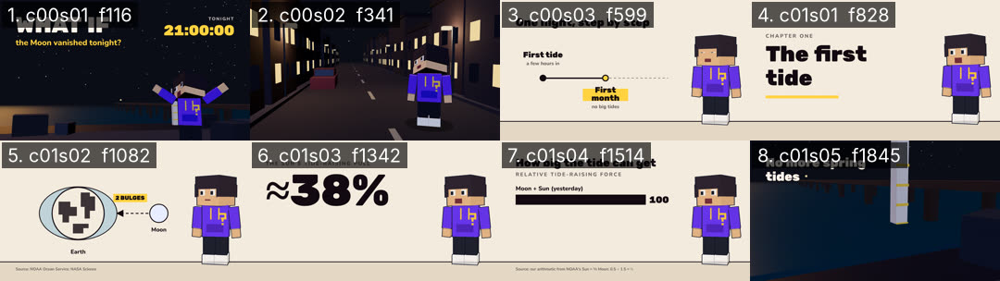

# Critique — LongformDemo — round 3 of 3

- shot list: `longform/demo/shotlist.json` (8 shots, 2089 frames @ 30 fps)
- stills: middle frame of each shot, `floor((start+end)/2)`, scale 0.5 — `critique/rounds/stills/LongformDemo-r3/`
- contact sheet: 
- generated: 2026-11-02 by `node critique/critique.mjs LongformDemo --shotlist longform/demo/shotlist.json --round 3 --fast --gl swangle`
- previous round: 2 — locked (all ≥ 8, don't touch): c01s02; fixed this round: c00s03, c00s01, c00s02

## How to score

Open each still (and the contact sheet) at phone size. Score 1–10 per column; a column is ≥ 8 only if you would ship it.

- **story** — does this frame advance the beat/state in the shot list (the bold end-state)? one idea per frame?
- **composition** — hierarchy, safe zones (top 220 / bottom 340 / right rail 160 px at 1080×1920), balance, negative space.
- **motion** — is the move readable mid-shot, eased, motivated; nothing static that should move or vice-versa.
- **type** — size ≥ 4.5 % of frame height for captions, contrast, 3–5 word chunks, ≤ 2 lines, accent colour only on money words.
- **sync** — does the picture event land on the beat / VO word / sfx peak (± 1 frame)?

<!-- SCORES:BEGIN -->
| # | shot | frames | mid frame | caption | action → end state | story | composition | motion | type | sync | total | notes |
|---|------|--------|-----------|---------|--------------------|---|---|---|---|---|-------|-------|
| 1 | c00s01 | 0–233 | [116](stills/LongformDemo-r3/c00s01-f0116.png) (3.87s) | Tonight, at exactly nine o'clock, | whatif/shore | 8 | 8 | 8 | 8 | 9 | 41 | Moon now in the clear sky between title and Q (checked f10/f60/f85), vanishes on "disappears" with the clock at 21:00:00 |
| 2 | c00s02 | 233–449 | [341](stills/LongformDemo-r3/c00s02-f0341.png) (11.37s) | The sky gets darker, sure. | narrator/street | 8 | 8 | 8 | 8 | 8 | 40 | low → push cut on "But": full figure on the street, points on "beach" |
| 3 | c00s03 | 449–749 | [599](stills/LongformDemo-r3/c00s03-f0599.png) (19.97s) | So let's follow it, step | timeline | 8 | 7 | 8 | 8 | 8 | 39 | labels inside the safe area; dashed track makes the journey read; still a lot of empty paper mid-scene |
| 4 | c01s01 | 749–908 | [828](stills/LongformDemo-r3/c01s01-f0828.png) (27.60s) | A few hours after the | title | 7 | 8 | 7 | 9 | 8 | 39 | unchanged — clean but the card only talks |
| 5 | c01s02 🔒 | 908–1257 | [1082](stills/LongformDemo-r3/c01s02-f1082.png) (36.07s) | Tides are mostly the Moon's | diagram | 9 | 8 | 8 | 8 | 8 | 41 | |
| 6 | c01s03 | 1257–1428 | [1342](stills/LongformDemo-r3/c01s03-f1342.png) (44.73s) | The Sun pulls on the | bigNumber | 7 | 7 | 8 | 8 | 8 | 38 | unchanged — lower half empty |
| 7 | c01s04 | 1428–1601 | [1514](stills/LongformDemo-r3/c01s04-f1514.png) (50.47s) | Take the Moon away, and | compareBars | 8 | 7 | 8 | 8 | 8 | 39 | unchanged — bottom third empty |
| 8 | c01s05 | 1601–2089 | [1845](stills/LongformDemo-r3/c01s05-f1845.png) (61.50s) | And there's a second change | narrator/shore → **re-hook** | 7 | 7 | 8 | 8 | 8 | 38 | unchanged since r2 — gauge drop real but subtle (1 mark) |
<!-- SCORES:END -->

## Rule

Fix the 3 worst shots (lowest total; ties → lowest sync). Lock everything that scored ≥ 8 (don't touch it). Re-render. Repeat until every shot is ≥ 8 in every column. Max 3 rounds; after round 3 ship the best round and log what's still under 8.

Then run `node critique/score.mjs critique/rounds/LongformDemo-round-3.md` — it totals the table, names the 3 worst shots and says whether to stop.

## Fix log (fill in after scoring)

- shot — what was wrong → what you changed

<!-- VERDICT:BEGIN -->
## Verdict (score.mjs)

- worst 3: c01s03 (38), c01s05 (38), c00s03 (39)
- locked: c00s01, c00s02, c01s02
- under 8: c00s03.composition=7, c01s01.story=7, c01s01.motion=7, c01s03.story=7, c01s03.composition=7, c01s04.composition=7, c01s05.story=7, c01s05.composition=7
- **MAX ROUNDS — round 3 of 3 still has 8 cell(s) under 8. No round 4: ship round 3 (fewest sub-8 cells: 8, mean total 39.4) and log what's still under 8.**
<!-- VERDICT:END -->
