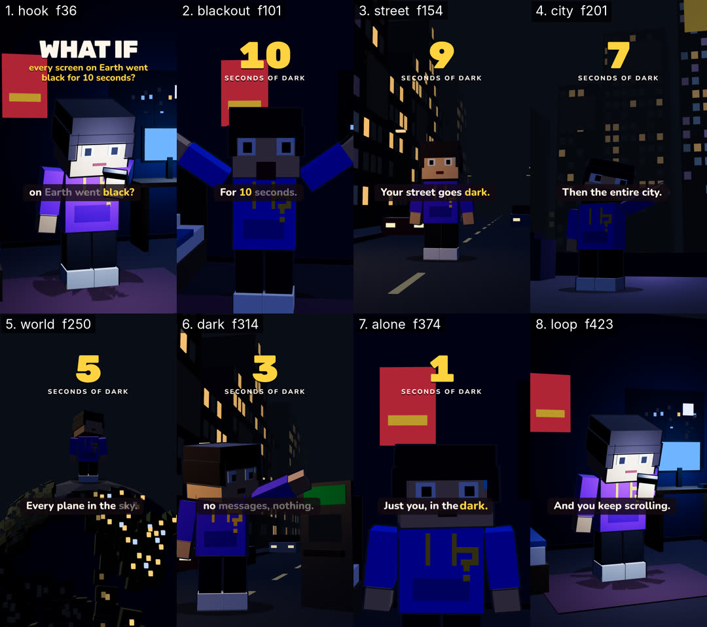

# Critique — QrosityDemo — round 1 of 3

- shot list: `examples/qrosity-demo/shotlist.json` (8 shots, 450 frames @ 30 fps)
- stills: middle frame of each shot, `floor((start+end)/2)`, scale 0.5 — `critique/rounds/stills/QrosityDemo-r1/`
- contact sheet: 
- generated: 2026-11-02 by `node critique/critique.mjs QrosityDemo --shotlist examples/qrosity-demo/shotlist.json --round 1 --fast --gl swangle`

## How to score

Open each still (and the contact sheet) at phone size. Score 1–10 per column; a column is ≥ 8 only if you would ship it.

- **story** — does this frame advance the beat/state in the shot list (the bold end-state)? one idea per frame?
- **composition** — hierarchy, safe zones (top 220 / bottom 340 / right rail 160 px at 1080×1920), balance, negative space.
- **motion** — is the move readable mid-shot, eased, motivated; nothing static that should move or vice-versa.
- **type** — size ≥ 4.5 % of frame height for captions, contrast, 3–5 word chunks, ≤ 2 lines, accent colour only on money words.
- **sync** — does the picture event land on the beat / VO word / sfx peak (± 1 frame)?

<!-- SCORES:BEGIN -->
| # | shot | frames | mid frame | caption | action → end state | story | composition | motion | type | sync | total | notes |
|---|------|--------|-----------|---------|--------------------|---|---|---|---|---|-------|-------|
| 1 | hook | 0–73 | [36](stills/QrosityDemo-r1/hook-f0036.png) (1.20s) | What if every screen | push-in on Q in his bedroom, face lit only by his phone and the monitor; WHAT IF title over the scene → **Q mid-scroll, phone + monitor glowing, WHAT IF title on screen** | 8 | 7 | 8 | 8 | 8 | 39 | WHAT IF + phone-lit face reads in <1 s, push-in; red poster top-left competes with the title |
| 2 | blackout | 73–130 | [101](stills/QrosityDemo-r1/blackout-f0101.png) (3.37s) | For 10 seconds | on "black?" every screen dies — room drops to moonlight, 7-frame shake, Q's shocked take; "10" countdown lands on "10" → **dark bedroom lit by the window only, Q shocked, countdown 9** | 8 | 6 | 8 | 8 | 8 | 38 | shake+take on 'black?', 10 lands on 'ten'; very tight framing, arms leave frame, face murky, poster behind the countdown |
| 3 | street | 130–178 | [154](stills/QrosityDemo-r1/street-f0154.png) (5.13s) | Your street goes dark | Q in the middle of his street; billboards and TV-lit windows die in a wave rolling from the far end toward him → **street dark except the warm lamps, Q worried, countdown 8** | 8 | 8 | 7 | 8 | 8 | 39 | wave of dead windows/billboards reads; Q only idles (look sweep) — little body motion |
| 4 | city | 178–224 | [201](stills/QrosityDemo-r1/city-f0201.png) (6.70s) | Then the entire city | low angle on Q on a rooftop; the skyline's screens and billboards go dark left to right behind him → **skyline black, Q pointing at it, countdown 6** | 7 | 5 | 7 | 7 | 8 | 34 | caption plate sits ON Q's face (ban); camera target too high, skyline good |
| 5 | world | 224–276 | [250](stills/QrosityDemo-r1/world-f0250.png) (8.33s) | Every plane in the sky | orbit around a blocky night-side Earth with Q standing on top; city lights and planes' lights go out in a sweep → **dark globe, planes drifting dark, Q tiny on top, countdown 5** | 7 | 6 | 8 | 8 | 7 | 36 | globe reads only half; no plane visible at mid-shot though the VO says 'every plane'; Q dark and small |
| 6 | dark | 276–352 | [314](stills/QrosityDemo-r1/dark-f0314.png) (10.47s) | No maps, no money | back on the dark street, low angle — Q jabs a dead ATM screen; nothing answers → **Q pointing at a black ATM screen, countdown 2** | 6 | 6 | 7 | 7 | 7 | 33 | ATM doesn't read as an ATM ('no money' lost); caption over Q's chin; big cropped head |
| 7 | alone | 352–397 | [374](stills/QrosityDemo-r1/alone-f0374.png) (12.47s) | Just you, in the dark | bust of Q alone in the dark bedroom, moon rim only; the countdown hits 1 → **Q worried in the dark, countdown 1** | 8 | 7 | 7 | 7 | 8 | 37 | caption plate crosses his mouth; red poster competes with the countdown |
| 8 | loop | 397–450 | [423](stills/QrosityDemo-r1/loop-f0423.png) (14.10s) | And you keep scrolling | screens snap back on (click) — light floods Q's face, he goes straight back to scrolling; camera glides to the frame-0 shot, WHAT IF lands (thump) → **identical to frame 0 — Q scrolling, phone lit, WHAT IF title (loop seam)** | 8 | 8 | 8 | 8 | 8 | 40 | lights snap on with the click, glide back to the frame-0 camera |
<!-- SCORES:END -->

## Rule

Fix the 3 worst shots (lowest total; ties → lowest sync). Lock everything that scored ≥ 8 (don't touch it). Re-render. Repeat until every shot is ≥ 8 in every column. Max 3 rounds; after round 3 ship the best round and log what's still under 8.

Then run `node critique/score.mjs critique/rounds/QrosityDemo-round-1.md` — it totals the table, names the 3 worst shots and says whether to stop.

## Fix log (fill in after scoring)

<!-- VERDICT:BEGIN -->
## Verdict (score.mjs)

- worst 3: dark (33), city (34), world (36)
- locked: loop
- under 8: hook.composition=7, blackout.composition=6, street.motion=7, city.story=7, city.composition=5, city.motion=7, city.type=7, world.story=7, world.composition=6, world.sync=7, dark.story=6, dark.composition=6, dark.motion=7, dark.type=7, dark.sync=7, alone.composition=7, alone.motion=7, alone.type=7
- **CONTINUE — fix dark, city, world; keep locked shots untouched; re-render; then: node critique/critique.mjs QrosityDemo --shotlist <file> --round 2**
<!-- VERDICT:END -->
- dark — ATM unreadable, caption over chin → ATM rebuilt (lit green "$" header from boxes, dead screen, keypad, card + cash slots); camera target.y 2.5 → 1.8
- city — caption plate on Q's face → camera target.y 3.0 → 1.6, height 0.9 → 0.6 (still a low angle)
- world — no plane visible at mid-shot, globe muddy → planes circle above Q (r 3.4–5 m, alt 3.2–5 m, 1.5× scale) and tip/drop when dark; ocean #173A6A → #215296; front fill 0.55 → 1.3
