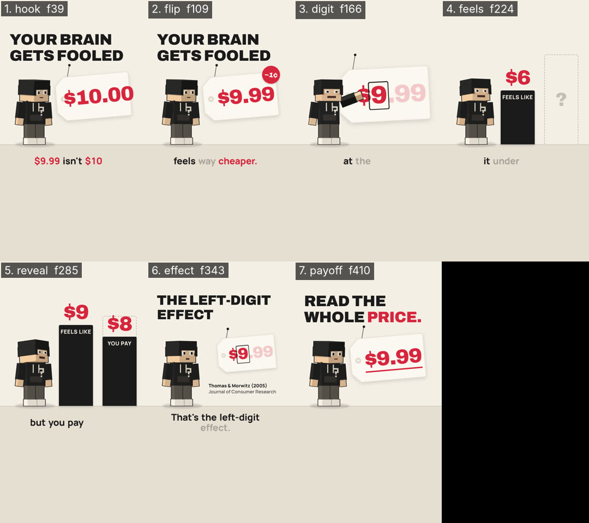

# Critique — SignalDemo — round 2 of 3

- shot list: `examples/signal-demo/shotlist.json` (7 shots, 450 frames @ 30 fps)
- stills: middle frame of each shot, `floor((start+end)/2)`, scale 0.5 — `critique/rounds/stills/SignalDemo-r2/`
- contact sheet: 
- generated: 2026-11-02 by `node critique/critique.mjs SignalDemo --shotlist examples/signal-demo/shotlist.json --round 2 --fast --gl swangle`
- previous round: 1 — locked (all ≥ 8, don't touch): payoff; fixed this round: reveal, effect, feels

## How to score

Open each still (and the contact sheet) at phone size. Score 1–10 per column; a column is ≥ 8 only if you would ship it.

- **story** — does this frame advance the beat/state in the shot list (the bold end-state)? one idea per frame?
- **composition** — hierarchy, safe zones (top 220 / bottom 340 / right rail 160 px at 1080×1920), balance, negative space.
- **motion** — is the move readable mid-shot, eased, motivated; nothing static that should move or vice-versa.
- **type** — size ≥ 4.5 % of frame height for captions, contrast, 3–5 word chunks, ≤ 2 lines, accent colour only on money words.
- **sync** — does the picture event land on the beat / VO word / sfx peak (± 1 frame)?

<!-- SCORES:BEGIN -->
| # | shot | frames | mid frame | caption | action → end state | story | composition | motion | type | sync | total | notes |
|---|------|--------|-----------|---------|--------------------|---|---|---|---|---|-------|-------|
| 1 | hook | 0–79 | [39](stills/SignalDemo-r2/hook-f0039.png) (1.30s) | $9.99 isn't $10 | $9.99 tag hangs on its string, the person looks at it; on "$10" the tag flips to $10.00 → **tag shows $10.00, headline YOUR BRAIN GETS FOOLED, person looking at the tag** | 8 | 8 | 7 | 8 | 8 | 39 | unchanged — nothing new lands between the flip (f34) and the cut (f79) |
| 2 | flip | 79–140 | [109](stills/SignalDemo-r2/flip-f0109.png) (3.63s) | One cent less | a red −1¢ sticker lands on "cent"; the tag flips back to $9.99 on "less"; price pops on "cheaper" → **tag shows $9.99 with the −1¢ sticker, person happy** | 8 | 7 | 8 | 8 | 8 | 39 | unchanged — sticker crowds the tag corner |
| 3 | digit | 140–193 | [166](stills/SignalDemo-r2/digit-f0166.png) (5.53s) | Your eyes stop | tag pushes in; ".99" greys out, an ink box draws around the left 9; person points; the 9 pops on "9" → **big tag, "$9" boxed in ink, ".99" faded, person pointing at it** | 8 | 6 | 8 | 7 | 8 | 37 | unchanged — pointing hand still covers the $ of the hero price |
| 4 | feels | 193–255 | [224](stills/SignalDemo-r2/feels-f0224.png) (7.47s) | it under $9, | bar A grows and counts $1→$9, landing on "$9"; bar B waits as a dashed "?" outline → **bar A "FEELS LIKE" $9 landed, bar B empty dashed outline, person looking at the bars** | 8 | 7 | 8 | 8 | 8 | 39 | bars 660 px, $ number up top; still ~25% empty space above the person |
| 5 | reveal | 255–316 | [285](stills/SignalDemo-r2/reveal-f0285.png) (9.50s) | but you pay $10 | bar B counts $1→$10 through the pause and lands on "$10."; riser → cash-register; person's shocked take → **bar B "YOU PAY" $10 taller than bar A, person in the shocked pose** | 8 | 7 | 8 | 7 | 8 | 38 | bar height now locked to the number ($8 < $9 ✓); the dashed '?' guide cuts through the $8 numeral |
| 6 | effect | 316–370 | [343](stills/SignalDemo-r2/effect-f0343.png) (11.43s) | That's the left-digit effect | LEFT-DIGIT EFFECT headline rises out of its mask on "left-digit"; the study line wipes in under the tag → **headline THE LEFT-DIGIT EFFECT, small $9.99 tag with the 9 boxed, source line, person worried** | 8 | 8 | 7 | 8 | 8 | 39 | headline lands on 'left-digit'; gaze at the tag; after landing ~1 s of hold with only the source wipe |
| 7 | payoff 🔒 | 370–450 | [410](stills/SignalDemo-r2/payoff-f0410.png) (13.67s) | Read the whole price | READ THE WHOLE PRICE lands; ".99" turns red and underlines on "price"; frame-0 headline returns (thump) → **identical to frame 0 — $9.99 tag, YOUR BRAIN GETS FOOLED, person looking at the tag (loop seam)** | 8 | 8 | 8 | 8 | 8 | 40 | |
<!-- SCORES:END -->

## Rule

Fix the 3 worst shots (lowest total; ties → lowest sync). Lock everything that scored ≥ 8 (don't touch it). Re-render. Repeat until every shot is ≥ 8 in every column. Max 3 rounds; after round 3 ship the best round and log what's still under 8.

Then run `node critique/score.mjs critique/rounds/SignalDemo-round-2.md` — it totals the table, names the 3 worst shots and says whether to stop.

## Fix log (fill in after scoring)

- digit — pointing hand covered the $ of the hero price → TAG_DIGIT hole 396,708 @1.22 → 470,660 @1.10 (the hand now meets the tag's punched end)
- reveal — dashed "?" guide cut through the counting numerals → guide exits (0.2 s, cubic in) as bar B starts counting
- hook — 45 f with nothing landing after the flip → worried take keyed to "brain" (f61); $10.00 face at 0.88× so it clears the tag edge

<!-- VERDICT:BEGIN -->
## Verdict (score.mjs)

- worst 3: digit (37), reveal (38), hook (39)
- locked: payoff
- under 8: hook.motion=7, flip.composition=7, digit.composition=6, digit.type=7, feels.composition=7, reveal.composition=7, reveal.type=7, effect.motion=7
- **CONTINUE — fix digit, reveal, hook; keep locked shots untouched; re-render; then: node critique/critique.mjs SignalDemo --shotlist <file> --round 3**
<!-- VERDICT:END -->
