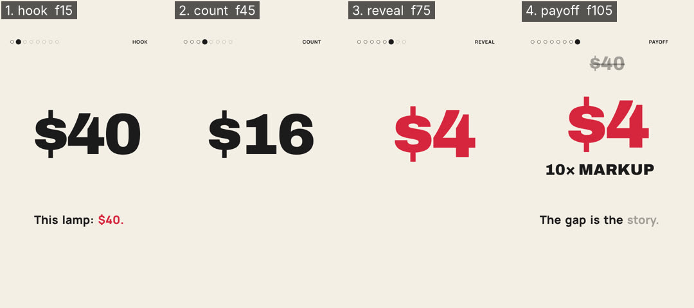

# Critique — ToolkitSmoke — round 2 of 3

- shot list: `src/smoke/smoke.shotlist.json` (4 shots, 120 frames @ 30 fps)
- stills: middle frame of each shot, `floor((start+end)/2)`, scale 0.5 — `critique/rounds/stills/ToolkitSmoke-r2/`
- contact sheet: 
- generated: 2026-11-02 by `node critique/critique.mjs ToolkitSmoke --shotlist src/smoke/smoke.shotlist.json --fast`
- previous round: 1 — locked (all ≥ 8, don't touch): hook, reveal, payoff; fixed this round: count

## How to score

Open each still (and the contact sheet) at phone size. Score 1–10 per column; a column is ≥ 8 only if you would ship it.

- **story** — does this frame advance the beat/state in the shot list (the bold end-state)? one idea per frame?
- **composition** — hierarchy, safe zones (top 220 / bottom 340 / right rail 160 px at 1080×1920), balance, negative space.
- **motion** — is the move readable mid-shot, eased, motivated; nothing static that should move or vice-versa.
- **type** — size ≥ 4.5 % of frame height for captions, contrast, 3–5 word chunks, ≤ 2 lines, accent colour only on money words.
- **sync** — does the picture event land on the beat / VO word / sfx peak (± 1 frame)?

<!-- SCORES:BEGIN -->
| # | shot | frames | mid frame | caption | action → end state | story | composition | motion | type | sync | total | notes |
|---|------|--------|-----------|---------|--------------------|---|---|---|---|---|-------|-------|
| 1 | hook 🔒 | 0–30 | [15](stills/ToolkitSmoke-r2/hook-f0015.png) (0.50s) | This lamp: $40. | Price tag $40 drops in and lands with a thump → **$40 centred, ink on cream, settled** | 9 | 9 | 9 | 9 | 9 | 45 | |
| 2 | count | 30–60 | [45](stills/ToolkitSmoke-r2/count-f0045.png) (1.50s) | Made for $4. | Number counts down 40 to 4, one tick per step → **counter frozen at 4, still ink** |  |  |  |  |  |  | |
| 3 | reveal 🔒 | 60–90 | [75](stills/ToolkitSmoke-r2/reveal-f0075.png) (2.50s) | Made for $4. | $4 flips to red and pops, ka-ching → **$4 in red, slightly larger than $40 was** | 9 | 9 | 9 | 9 | 9 | 45 | |
| 4 | payoff 🔒 | 90–120 | [105](stills/ToolkitSmoke-r2/payoff-f0105.png) (3.50s) | The gap is the story. | Struck-through $40 appears above, 10x MARKUP slams in under the $4 → **$40 struck through on top, $4 red centre, 10x MARKUP under** | 9 | 9 | 9 | 9 | 9 | 45 | |
<!-- SCORES:END -->

## Rule

Fix the 3 worst shots (lowest total; ties → lowest sync). Lock everything that scored ≥ 8 (don't touch it). Re-render. Repeat until every shot is ≥ 8 in every column. Max 3 rounds; after round 3 ship the best round and log what's still under 8.

Then run `node critique/score.mjs critique/rounds/ToolkitSmoke-round-2.md` — it totals the table, names the 3 worst shots and says whether to stop.

## Fix log (fill in after scoring)

- shot — what was wrong → what you changed
