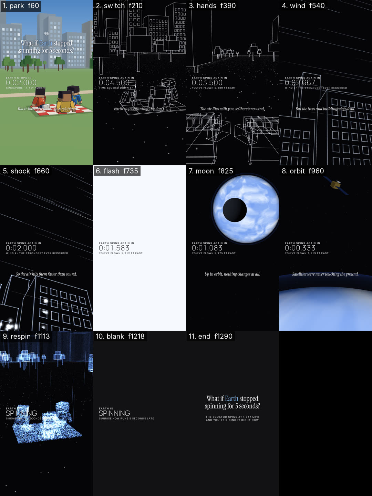

# Critique — WhatIfDemo — round 1 of 3

- shot list: `examples/whatif-countdown/shotlist.json` (11 shots, 1350 frames @ 30 fps)
- stills: middle frame of each shot, `floor((start+end)/2)`, scale 0.5 — `critique/rounds/stills/WhatIfDemo-r1/`
- contact sheet: 
- generated: 2026-11-02 by `node critique/critique.mjs WhatIfDemo --shotlist examples/whatif-countdown/shotlist.json --round 1 --fast --gl swangle`

## How to score

Open each still (and the contact sheet) at phone size. Score 1–10 per column; a column is ≥ 8 only if you would ship it.

- **story** — does this frame advance the beat/state in the shot list (the bold end-state)? one idea per frame?
- **composition** — hierarchy, safe zones (top 220 / bottom 340 / right rail 160 px at 1080×1920), balance, negative space.
- **motion** — is the move readable mid-shot, eased, motivated; nothing static that should move or vice-versa.
- **type** — size ≥ 4.5 % of frame height for captions, contrast, 3–5 word chunks, ≤ 2 lines, accent colour only on money words.
- **sync** — does the picture event land on the beat / VO word / sfx peak (± 1 frame)?

<!-- SCORES:BEGIN -->
| # | shot | frames | mid frame | caption | action → end state | story | composition | motion | type | sync | total | notes |
|---|------|--------|-----------|---------|--------------------|---|---|---|---|---|-------|-------|
| 1 | park | 0–120 | [60](stills/WhatIfDemo-r1/park-f0060.png) (2.00s) | You're having a picnic in Singapore. | [normal] calm push-in on three friends picnicking in a city park, skyline behind; title + real-time countdown | 8 | 6 | 7 | 7 | 8 | 36 | narration sits on the red/white blanket; title over busy lit windows; picnic low in frame, HUD near the red friend |
| 2 | switch | 120–300 | [210](stills/WhatIfDemo-r1/switch-f0210.png) (7.00s) | Earth stops spinning. You don't. | [xray] the world turns to white edges on black; trees and skyline stream west while the picnic keeps flying east | 8 | 6 | 8 | 6 | 8 | 36 | timer 0:04.500 crosses a friend; narration crosses the blanket wireframe — both hard to read |
| 3 | hands | 300–480 | [390](stills/WhatIfDemo-r1/hands-f0390.png) (13.00s) | The air flies with you, so there's no wind. | [hands] POV: your own wireframe hands; the star-point ground and trees rush toward and under you | 7 | 7 | 8 | 8 | 8 | 38 | hands read as stacked boxes more than hands; ground stream strong |
| 4 | wind | 480–600 | [540](stills/WhatIfDemo-r1/wind-f0540.png) (18.00s) | But the trees and buildings stop dead. | [glow] the skyline, bolted to the ground, takes the wind: streaks race east and the edges start to glow | 7 | 7 | 8 | 7 | 8 | 37 | streaks read as wind; sub-label crosses building lines |
| 5 | shock | 600–720 | [660](stills/WhatIfDemo-r1/shock-f0660.png) (22.00s) | So the air hits them faster than sound. | [glow] low angle up the towers: the windows burst into sparkles in a wave from west to east, glow to max | 6 | 7 | 7 | 8 | 8 | 36 | window sparkles too sparse to sell "windows burst"; building cropped, top empty |
| 6 | flash | 720–750 | [735](stills/WhatIfDemo-r1/flash-f0735.png) (24.50s) |  | [whiteout] white-out (the shock front) | 8 | 8 | 8 | 8 | 8 | 40 | white-out; HUD flips to ink |
| 7 | moon | 750–900 | [825](stills/WhatIfDemo-r1/moon-f0825.png) (27.50s) | Up in orbit, nothing changes at all. | [space] scale jump: the glowing planet in space; the dark Moon slides across in front | 8 | 8 | 8 | 8 | 8 | 40 | planet + moon eclipse, HUD/narration on black |
| 8 | orbit | 900–1020 | [960](stills/WhatIfDemo-r1/orbit-f0960.png) (32.00s) | Satellites were never touching the ground. | [space] low orbit: the bright curved horizon fills the frame, a satellite drifts by untouched | 8 | 7 | 7 | 8 | 8 | 38 | satellite small in the corner; horizon good |
| 9 | respin | 1020–1206 | [1113](stills/WhatIfDemo-r1/respin-f1113.png) (37.10s) |  | [pointcloud] the park and the friends rebuild as a blue point cloud; streaks shoot up; slow orbit | 8 | 5 | 8 | 5 | 8 | 34 | "SPINNING" + sub-label sit on the point-cloud friends — unreadable; picnic hugs the HUD |
| 10 | blank | 1206–1230 | [1218](stills/WhatIfDemo-r1/blank-f1218.png) (40.60s) |  | [blank] near-black beat before the end card | 8 | 8 | 8 | 8 | 8 | 40 | intended beat; HUD holds |
| 11 | end | 1230–1350 | [1290](stills/WhatIfDemo-r1/end-f1290.png) (43.00s) |  | [endcard] end card: the question again + one fact line (loops into frame 0) | 8 | 8 | 8 | 8 | 8 | 40 | title + fact lines at measured positions |
<!-- SCORES:END -->

## Rule

Fix the 3 worst shots (lowest total; ties → lowest sync). Lock everything that scored ≥ 8 (don't touch it). Re-render. Repeat until every shot is ≥ 8 in every column. Max 3 rounds; after round 3 ship the best round and log what's still under 8.

Then run `node critique/score.mjs critique/rounds/WhatIfDemo-round-1.md` — it totals the table, names the 3 worst shots and says whether to stop.

## Fix log (fill in after scoring)

- respin — HUD "SPINNING" over the point-cloud friends → camera reframed with a projection check so the picnic sits right of x 480 and between y 820–1100 (the opening framing, orbiting); HUD over empty ground
- park — narration over the blanket, picnic crowding the HUD → camera pulled back (fov 46 → 40, dist ≈ 20 m) so the picnic sits x 560–1040, y 840–1090, above the narration band; skyline windows lower contrast under the title
- switch — timer over a friend, narration over blanket lines → starts on the park's end pose and pushes in to a pose checked the same way (all picnic points right of the HUD, above y 1120)

<!-- VERDICT:BEGIN -->
## Verdict (score.mjs)

- worst 3: respin (34), park (36), switch (36)
- locked: flash, moon, blank, end
- under 8: park.composition=6, park.motion=7, park.type=7, switch.composition=6, switch.type=6, hands.story=7, hands.composition=7, wind.story=7, wind.composition=7, wind.type=7, shock.story=6, shock.composition=7, shock.motion=7, orbit.composition=7, orbit.motion=7, respin.composition=5, respin.type=5
- **CONTINUE — fix respin, park, switch; keep locked shots untouched; re-render; then: node critique/critique.mjs WhatIfDemo --shotlist <file> --round 2**
<!-- VERDICT:END -->
