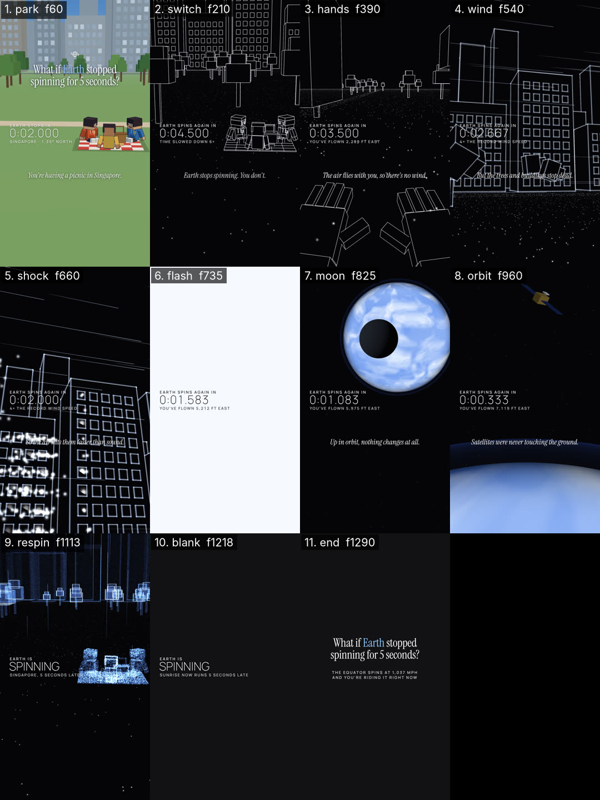

# Critique — WhatIfDemo — round 3 of 3

- shot list: `examples/whatif-countdown/shotlist.json` (11 shots, 1350 frames @ 30 fps)
- stills: middle frame of each shot, `floor((start+end)/2)`, scale 0.5 — `critique/rounds/stills/WhatIfDemo-r3/`
- contact sheet: 
- generated: 2026-11-02 by `node critique/critique.mjs WhatIfDemo --shotlist examples/whatif-countdown/shotlist.json --round 3 --fast --gl swangle`
- previous round: 2 — locked (all ≥ 8, don't touch): park, switch, flash, moon, blank, end; fixed this round: shock, wind, hands

## How to score

Open each still (and the contact sheet) at phone size. Score 1–10 per column; a column is ≥ 8 only if you would ship it.

- **story** — does this frame advance the beat/state in the shot list (the bold end-state)? one idea per frame?
- **composition** — hierarchy, safe zones (top 220 / bottom 340 / right rail 160 px at 1080×1920), balance, negative space.
- **motion** — is the move readable mid-shot, eased, motivated; nothing static that should move or vice-versa.
- **type** — size ≥ 4.5 % of frame height for captions, contrast, 3–5 word chunks, ≤ 2 lines, accent colour only on money words.
- **sync** — does the picture event land on the beat / VO word / sfx peak (± 1 frame)?

<!-- SCORES:BEGIN -->
| # | shot | frames | mid frame | caption | action → end state | story | composition | motion | type | sync | total | notes |
|---|------|--------|-----------|---------|--------------------|---|---|---|---|---|-------|-------|
| 1 | park 🔒 | 0–120 | [60](stills/WhatIfDemo-r3/park-f0060.png) (2.00s) | You're having a picnic in Singapore. | [normal] calm push-in on three friends picnicking in a city park, skyline behind; title + real-time countdown | 8 | 8 | 8 | 8 | 8 | 40 | |
| 2 | switch 🔒 | 120–300 | [210](stills/WhatIfDemo-r3/switch-f0210.png) (7.00s) | Earth stops spinning. You don't. | [xray] the world turns to white edges on black; trees and skyline stream west while the picnic keeps flying east | 8 | 8 | 8 | 8 | 8 | 40 | |
| 3 | hands | 300–480 | [390](stills/WhatIfDemo-r3/hands-f0390.png) (13.00s) | The air flies with you, so there's no wind. | [hands] POV: your own wireframe hands; the star-point ground and trees rush toward and under you | 8 | 8 | 8 | 8 | 8 | 40 | backs of both hands toward the lens, fingers up, stars through them; fingertips stop under the narration band |
| 4 | wind | 480–600 | [540](stills/WhatIfDemo-r3/wind-f0540.png) (18.00s) | But the trees and buildings stop dead. | [glow] the skyline, bolted to the ground, takes the wind: streaks race east and the edges start to glow | 8 | 7 | 8 | 7 | 8 | 38 | canopies torn off and flying east sell the impact; HUD timer still over a window grid, narration over flying canopies |
| 5 | shock | 600–720 | [660](stills/WhatIfDemo-r3/shock-f0660.png) (22.00s) | So the air hits them faster than sound. | [glow] low angle up the towers: the windows burst into sparkles in a wave from west to east, glow to max | 8 | 7 | 8 | 7 | 8 | 38 | window panes flash in a west→east wave + shards: reads as bursting; HUD and narration sit on facade lines |
| 6 | flash 🔒 | 720–750 | [735](stills/WhatIfDemo-r3/flash-f0735.png) (24.50s) |  | [whiteout] white-out (the shock front) | 8 | 8 | 8 | 8 | 8 | 40 | |
| 7 | moon 🔒 | 750–900 | [825](stills/WhatIfDemo-r3/moon-f0825.png) (27.50s) | Up in orbit, nothing changes at all. | [space] scale jump: the glowing planet in space; the dark Moon slides across in front | 8 | 8 | 8 | 8 | 8 | 40 | |
| 8 | orbit | 900–1020 | [960](stills/WhatIfDemo-r3/orbit-f0960.png) (32.00s) | Satellites were never touching the ground. | [space] low orbit: the bright curved horizon fills the frame, a satellite drifts by untouched | 8 | 7 | 7 | 8 | 8 | 38 | unchanged: satellite small in the corner; horizon good |
| 9 | respin | 1020–1206 | [1113](stills/WhatIfDemo-r3/respin-f1113.png) (37.10s) |  | [pointcloud] the park and the friends rebuild as a blue point cloud; streaks shoot up; slow orbit | 8 | 7 | 8 | 7 | 8 | 38 | unchanged: sub-label end touches the cloud |
| 10 | blank 🔒 | 1206–1230 | [1218](stills/WhatIfDemo-r3/blank-f1218.png) (40.60s) |  | [blank] near-black beat before the end card | 8 | 8 | 8 | 8 | 8 | 40 | |
| 11 | end 🔒 | 1230–1350 | [1290](stills/WhatIfDemo-r3/end-f1290.png) (43.00s) |  | [endcard] end card: the question again + one fact line (loops into frame 0) | 8 | 8 | 8 | 8 | 8 | 40 | |
<!-- SCORES:END -->

## Rule

Fix the 3 worst shots (lowest total; ties → lowest sync). Lock everything that scored ≥ 8 (don't touch it). Re-render. Repeat until every shot is ≥ 8 in every column. Max 3 rounds; after round 3 ship the best round and log what's still under 8.

Then run `node critique/score.mjs critique/rounds/WhatIfDemo-round-3.md` — it totals the table, names the 3 worst shots and says whether to stop.

## Fix log (fill in after scoring)

- shot — what was wrong → what you changed

<!-- VERDICT:BEGIN -->
## Verdict (score.mjs)

- worst 3: wind (38), shock (38), orbit (38)
- locked: park, switch, hands, flash, moon, blank, end
- under 8: wind.composition=7, wind.type=7, shock.composition=7, shock.type=7, orbit.composition=7, orbit.motion=7, respin.composition=7, respin.type=7
- **MAX ROUNDS — round 3 of 3 still has 8 cell(s) under 8. No round 4: ship round 3 (fewest sub-8 cells: 8, mean total 39.3) and log what's still under 8.**
<!-- VERDICT:END -->
