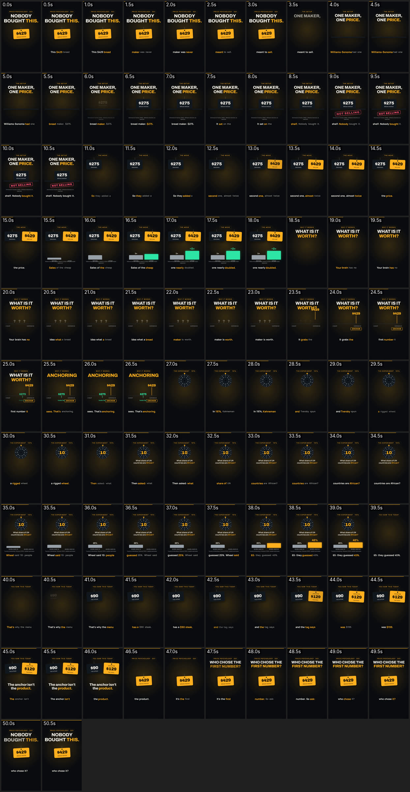

# Style guide — from `SignalAnchoring-draft.mp4`

> Generated by `scripts/style-guide-from-reference/index.mjs`. Numbers marked **measured** come from the
> video; everything in _italics_ is for Claude/you to fill by READING `contact-sheet.jpg` (and the
> frames). Then turn it into rules: "Rules to copy" and "Banned in our version" are what the build obeys.

| | measured |
|---|---|
| format | 540×960 @ 60.00 fps, 51.00 s |
| sampled | 102 frames, one every 0.5 s |
| audio | none |

## Palette

**Measured dominant colours** (share of all sampled pixels):

| hex | coverage | saturation | luma | role |
|---|---|---|---|---|
| `#0E0F0F` | 86.94% | 0.07 | 15 | _role?_ |
| `#2B2415` | 4.92% | 0.51 | 37 | _role?_ |
| `#F9AE1E` | 1.4% | 0.88 | 180 | _role?_ |
| `#785617` | 1.17% | 0.81 | 88 | _role?_ |
| `#3F403F` | 1.16% | 0.01 | 64 | _role?_ |
| `#503A15` | 0.75% | 0.74 | 60 | _role?_ |
| `#5D5C58` | 0.57% | 0.06 | 92 | _role?_ |
| `#9E9F9E` | 0.56% | 0.01 | 159 | _role?_ |

**Measured accent candidates** (saturated, ≥ 0.2 % coverage): `#F9AE1E` (1.4%), `#785617` (1.17%), `#503A15` (0.75%), `#A2721A` (0.45%)
Mean luma: **24/255** (dark ground).

- Ground: _…_  · Ink/text: _…_  · Accent(s) and WHEN they appear: _…_
- Our mapping (The Signal: cream `#F4EFE6`, ink `#1B1B1B`, red `#D7263D` for money words only): _…_

## Type

| element | face (guess) | size (% of frame height) | weight | case | tracking | colour |
|---|---|---|---|---|---|---|
| headline | _…_ | _…_ | _…_ | _…_ | _…_ | _…_ |
| hero number | _…_ | _…_ | _…_ | _…_ | _…_ | _…_ |
| caption | _…_ | _…_ | _…_ | _…_ | _…_ | _…_ |
| label/kicker | _…_ | _…_ | _…_ | _…_ | _…_ | _…_ |

(At 1920 px tall: 1 % ≈ 19 px. Captions on phones read at ≥ 4.5 % ≈ 86 px.)

## Shot lengths

**Measured** with `select='gt(scene,0.3)'` (hard cuts / big changes only — morphs and in-place
builds are NOT counted, so real "beats" are usually shorter):

| shots | mean | median | min | max |
|---|---|---|---|---|
| 1 | 51.00 s (1530 f@30) | 51.00 s | 51.00 s (1530 f) | 51.00 s (1530 f) |

Cuts at: (none detected — try --scene 0.2)

- Rhythm notes (what changes every beat inside a shot?): _…_

## Transitions

- _hard cut / whip / morph / match cut / push … which, how often, how long (frames)_

## Camera

- _static / slow push / truck / zoom punch-ins; easing; how much movement per shot_

## Grain / texture

- _flat / grain / vignette / glow / paper texture; gradients (watch h264 banding)_

## How text enters / exits

- _per-word / per-line / whole block; rise px; fade; duration in frames; exit faster than entry?_
- _caption chunk size (words), lines, position (y % of height), highlight of the spoken word_

## Sound notes

No audio stream in the reference.

- Music: _tempo / genre / energy curve_ · SFX: _which events get a sound; whoosh on cuts? pops on numbers?_
- VO pace: _words/s_ · Ducking: _…_

## Rules to copy

1. _…_
2. _…_
3. _…_

## Banned in our version

1. _… (anything that would read as a copy: their exact layout, their colours, their characters, their fonts if distinctive)_
2. _…_
